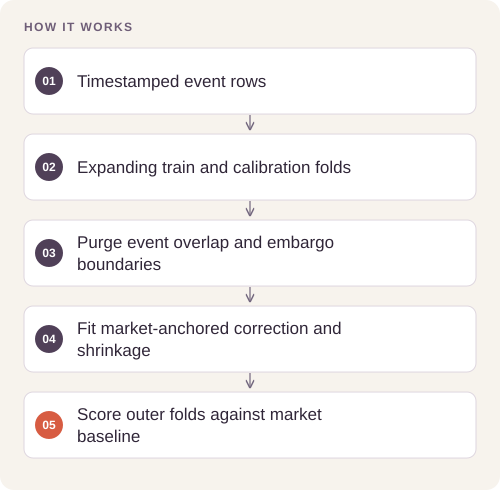

# Forecasting and Historical Replay Lab

**Feras Elghandour**

Evaluate whether an added signal improves probability forecasts while preserving event and timestamp boundaries.

## Implementation

A market-anchored probability model, shrinkage calibration, event-purged expanding evaluation, uncertainty summaries, and cash-constrained hypothetical replay. Public-data adapters are GET-only; no orders, credentials, or account operations are implemented.




## Reproduce and inspect

The executable reproduction profile now records exact commands, input/source hashes, dependency versions, logs and pass/fail status. Its scope distinguishes behavior checks from full-data benchmarks.

[Commands, artifacts and benchmark scope](BENCHMARKS.md) · [Versioned profiles](reproduction.json)


## Try a small example

Generated market-like rows exercise fold construction and scoring. These scores are not results on live markets or evidence of trading benefit.

After the local setup below, run from the repository root:

```sh
python examples/quickstart.py
```

The [example source](examples/quickstart.py), [captured output](examples/expected-output.txt) and [execution record](examples/environment.json) keep this demonstration inspectable. Floating-point values may vary with library versions.

Observed output from this run:

```text
{'rows': 250, 'events': 250, 'fitted_rows': 250, 'market_brier': 0.20102622436081138, 'forecast_brier': 0.17513378455788578}
```

## Evidence and results

**36 tests pass.** Three reproducible synthetic controls exercise planted signal, no added signal, and regime reversal. The retained controls show Brier scores of **0.201646 → 0.175714**, **0.181112 → 0.180819**, and **0.197706 → 0.218955**, respectively. A separate historical market study did not establish a reliable advantage; absent fee/depth evidence prevents strict simulated fills.

## Run locally

Python 3.11 or later; use an isolated environment.

```sh
python -m pip install -r requirements.txt
python -m unittest discover -s tests -v
python reproduce.py --output reproduced
```

The reproduction command generates synthetic input locally and writes a new folder. Historical aggregate results remain in `results/`; raw third-party market feeds are excluded. [Research findings](FINDINGS.md) explain the failed real-data comparison and replay assumptions.

## Scope and limitations

A research and replay tool. Synthetic gains do not establish attainable financial returns. Historical model scores and assumed-fill results have different evidential scope. Fee schedules and API behavior require independent current verification before a new study.

[Validation record](VALIDATION.md) · [Inputs and applicable notices](DATA.md)

## Reuse

The original contributions listed in [LICENSING.md](LICENSING.md) are available under [MIT](LICENSE). This scoped grant preserves upstream notices and separate dataset, simulator, notebook and checkpoint terms.
