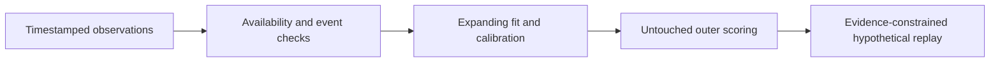

# Forecasting and Historical Replay Lab

**Feras Elghandour**

Evaluate whether an added signal improves probability forecasts while preserving event and timestamp boundaries.

## Implementation

A market-anchored probability model, shrinkage calibration, event-purged expanding evaluation, uncertainty summaries, and cash-constrained hypothetical replay. Public-data adapters are GET-only; no orders, credentials, or account operations are implemented.



## Evidence and results

**36 tests pass.** Three reproducible synthetic controls exercise planted signal, no added signal, and regime reversal. The retained controls show Brier scores of **0.201646 → 0.175714**, **0.181112 → 0.180819**, and **0.197706 → 0.218955**, respectively. A separate historical market study did not establish a reliable advantage; absent fee/depth evidence prevents strict simulated fills.

## Run locally

Python 3.11 or later; use an isolated environment.

```sh
python -m pip install -r requirements.txt
python -m unittest discover -s tests -v
python reproduce.py --output reproduced
```

The reproduction command generates synthetic input locally and writes a new folder. Historical aggregate results remain in `results/`; raw third-party market feeds are excluded. [Research findings](FINDINGS.md) explain the failed real-data comparison and replay assumptions.

## Scope and limitations

A research and replay tool. Synthetic gains do not establish attainable financial returns. Historical model scores and assumed-fill results have different evidential scope. Fee schedules and API behavior require independent current verification before a new study.

[Validation record](VALIDATION.md) · [Inputs and applicable notices](DATA.md)
